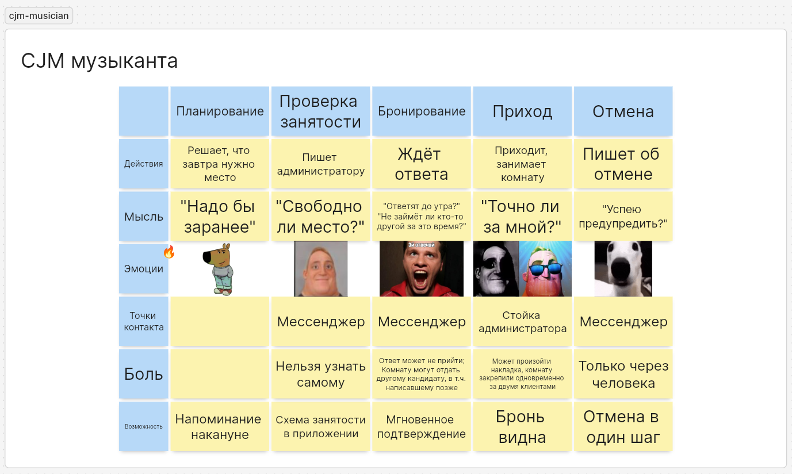
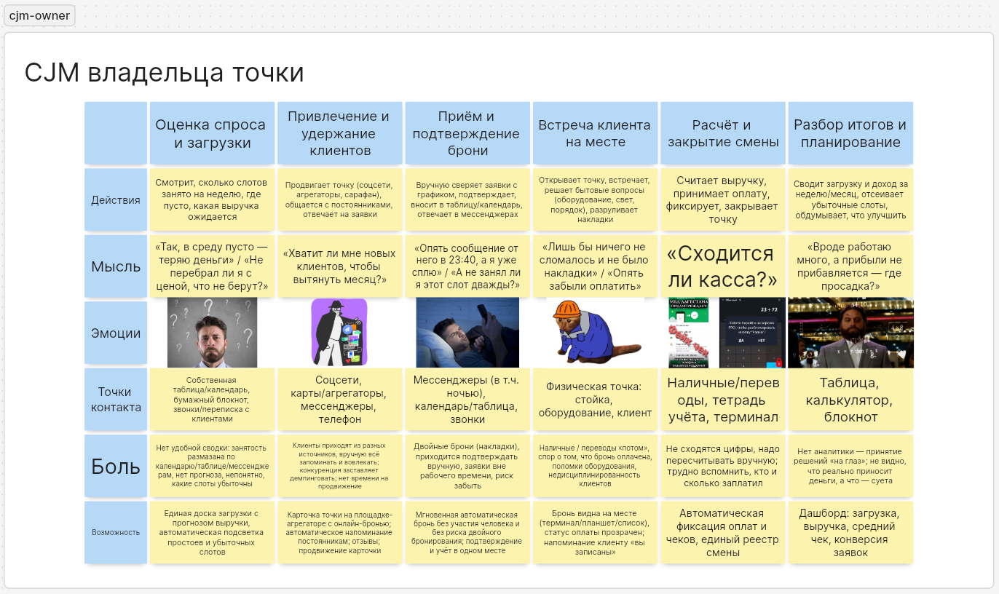

# Карта пути клиента

## Музыкант-клиент

Сценарий: найти место и забронировать репетицию без постоянной переписки.

| Слой               | Планирование                   | Проверка занятости           | Бронирование                                                                                 | Приход                                                                      | Отмена                    |
| ------------------ | ------------------------------ | ---------------------------- | -------------------------------------------------------------------------------------------- | --------------------------------------------------------------------------- | ------------------------- |
| **Действие**       | Решает, что завтра нужно место | Пишет администратору         | Ждёт ответа                                                                                  | Приходит, занимает комнату                                                  | Пишет об отмене           |
| **Мысль**          | «Надо бы заранее»              | «Свободно ли место?»         | «Ответят до утра?» «Не займёт ли кто-то другой за это время?»                                | «Точно ли за мной?»                                                         | «Успею предупредить?»     |
| **Эмоция**         | Бодрое, деловое настроение     | Недоумение, лёгкая тревога   | Злость и раздражение от ожидания                                                             | Облегчение или досада, как повезёт                                          | Растерянность, неловкость |
| **Точка контакта** | —                              | Мессенджер                   | Мессенджер                                                                                   | Стойка администратора                                                       | Мессенджер                |
| **Боль**           | —                              | Нельзя узнать самому         | Ответ может не прийти; комнату могут отдать другому кандидату, в том числе написавшему позже | Может произойти накладка: комнату закрепили одновременно за двумя клиентами | Только через человека     |
| **Возможность**    | Напоминание накануне           | Схема занятости в приложении | Мгновенное подтверждение                                                                     | Бронь видна на месте                                                        | Отмена в один шаг         |

### Вывод: три самые дорогие боли

1. **Нельзя узнать занятость самому** (этап «Проверка занятости»). С неё начинается весь путь; из-за неё бронь вообще откладывается. Решается поиском со свободными слотами.
2. **Ответ не приходит, а место могут отдать другому** (этап «Бронирование»). Самая сильная негативная эмоция на карте. Решается мгновенным подтверждением и закреплением слота за пользователем.
3. **Накладка при приходе** (этап «Приход»). Худший исход: пришёл, а зал занят. Решается исключением двойных броней на уровне системы.

## Владелец репетиционной точки

Сценарий: обеспечить загрузку объекта для получения прибыли.

| Слой               | Оценка спроса и загрузки                                                                                                 | Привлечение и удержание клиентов                                                                                                           | Приём и подтверждение брони                                                                                                | Встреча клиента на месте                                                                                           | Расчёт и закрытие смены                                                                 | Разбор итогов и планирование                                                                     |
| ------------------ | ------------------------------------------------------------------------------------------------------------------------ | ------------------------------------------------------------------------------------------------------------------------------------------ | -------------------------------------------------------------------------------------------------------------------------- | ------------------------------------------------------------------------------------------------------------------ | --------------------------------------------------------------------------------------- | ------------------------------------------------------------------------------------------------ |
| **Действие**       | Смотрит, сколько слотов занято на неделю, где пусто, какая выручка ожидается                                             | Продвигает точку (соцсети, агрегаторы, сарафан), общается с постоянниками, отвечает на заявки                                              | Вручную сверяет заявки с графиком, подтверждает, вносит в таблицу/календарь, отвечает в мессенджерах                       | Открывает точку, встречает, решает бытовые вопросы (оборудование, свет, порядок), разруливает накладки             | Считает выручку, принимает оплату, фиксирует, закрывает точку                           | Сводит загрузку и доход за неделю/месяц, отсеивает убыточные слоты, обдумывает, что улучшить     |
| **Мысль**          | «Так, в среду пусто — теряю деньги» / «Не перебрал ли я с ценой, что не берут?»                                          | «Хватит ли мне новых клиентов, чтобы вытянуть месяц?»                                                                                      | «Опять сообщение от него в 23:40, а я уже сплю» / «А не занял ли я этот слот дважды?»                                      | «Лишь бы ничего не сломалось и не было накладки» / «Опять забыли оплатить»                                         | «Сходится ли касса?»                                                                    | «Вроде работаю много, а прибыли не прибавляется — где просадка?»                                 |
| **Эмоция**         | Тревога (простой = убыток), досада на пустые слоты                                                                       | Надежда, вовлечённость, а иногда — усталость от постоянных заявок в разных каналах                                                         | Раздражение и страх ошибки (человеческий фактор)                                                                           | Собранность, лёгкий стресс от ответственности                                                                      | Усталость, чувство контроля или тревога из-за расхождений                               | Задумчивость, уныние от «работы без продыху», азарт от хорошей недели                            |
| **Точка контакта** | Собственная таблица/календарь, бумажный блокнот, звонки/переписка с клиентами                                            | Соцсети, карты/агрегаторы, мессенджеры, телефон                                                                                            | Мессенджеры (в т.ч. ночью), календарь/таблица, звонки                                                                      | Физическая точка: стойка, оборудование, клиент                                                                     | Наличные/переводы, тетрадь учёта, терминал                                              | Таблица, калькулятор, блокнот                                                                    |
| **Боль**           | Нет удобной сводки: занятость размазана по календарю/таблице/мессенджерам, нет прогноза, непонятно, какие слоты убыточны | Клиенты приходят из разных источников, вручную всё запоминать и вовлекать; конкуренция заставляет демпинговать; нет времени на продвижение | Двойные брони (накладки), приходится подтверждать вручную, заявки вне рабочего времени, риск забыть                        | Наличные / переводы «потом», спор о том, что бронь оплачена, поломки оборудования, недисциплинированность клиентов | Не сходятся цифры, надо пересчитывать вручную; трудно вспомнить, кто и сколько заплатил | Нет аналитики — принятие решений «на глаз»; не видно, что реально приносит деньги, а что — суета |
| **Возможность**    | Единая доска загрузки с прогнозом выручки, автоматическая подсветка простоев и убыточных слотов                          | Карточка точки на площадке-агрегаторе с онлайн-бронью; автоматическое напоминание постоянникам; отзывы; продвижение карточки               | Мгновенная автоматическая бронь без участия человека и без риска двойного бронирования; подтверждение и учёт в одном месте | Бронь видна на месте (терминал/планшет/список), статус оплаты прозрачен; напоминание клиенту «вы записаны»         | Автоматическая фиксация оплат и чеков, единый реестр смены                              | Дашборд: загрузка, выручка, средний чек, конверсия заявок                                        |

### Вывод: три самые дорогие боли

1. **Двойные брони** (этап «Приём и подтверждение брони»). Прямо бьют по репутации точки и порождают конфликты с клиентами.
2. **Ручной приём броней и оплаты** (этапы «Приём и подтверждение брони» и «Расчёт и закрытие смены»). Съедает время и приводит к ошибкам.
3. **Неявки и поздние отмены без перепродажи** (этап «Встреча клиента на месте»). Прямые потери денег; нужны правила отмены и мгновенное освобождение слота.
