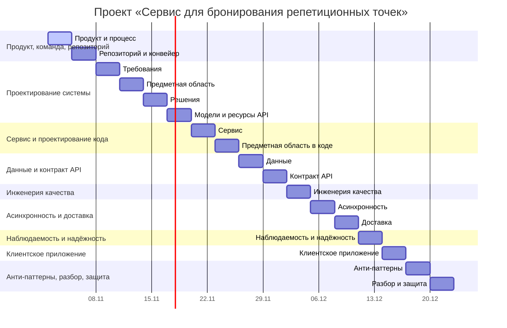

# План семестра

## Контрольные точки

| Точка | Срок | Критерий прохождения |
| --- | --- | --- |
| Требования намечены | Конец М01 | Домен согласован, MVP обозначен |
| Конвейер зелёный | Конец М02 | Ветка защищена, проверки проходят |
| API утверждён | Конец М10 | Контракт API формализован |
| Приложение готово | Конец М15 | Клиентское приложение демонстрирует работоспособность |
| MVP работает | Конец М17 | Сквозной сценарий проходится целиком |

## Буфер

20 % времени каждой секции заложено на непредвиденное. Расход буфера фиксируется в [CHANGELOG.md](CHANGELOG.md).

## Что урезаем первым при отставании на две недели

1. Оплату переводим на заглушку шлюза без реальных платёжных сценариев.
2. Откладываем из MVP просмотр броней владельцем в виде календаря: остаётся простой список.
3. Не трогаем: поиск, обеспечение отсутствия двойных броней, отмена брони.
