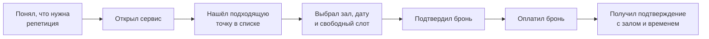
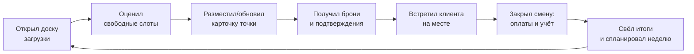

# Требования: сервис для бронирования репетиционных точек

## Предметная область

Проект: **сервис для бронирования репетиционных точек**. Музыкант находит зал, видит свободное время, бронирует и оплачивает онлайн. Владелец точки публикует залы, видит загрузку и не ведёт расписание вручную.

Проверим домен на соответствие четырём требованиям.

| Требование | Проверка | Итог |
| --- | --- | --- |
| Минимум 2–3 ограниченных контекста | Каталог точек и залов (точка, залы, оборудование, фото, адрес). Бронирование и расписание (слоты, брони, статусы, конфликты). Тарифы и оплата (цена по времени суток и дню недели, предоплата). Уведомления (подтверждения, напоминания, отмены) | ✅ Четыре |
| Внешняя интеграция | Платёжный шлюз (предоплата брони). Отправка уведомлений (e-mail или мессенджер). Карты (показ точек на карте и построение маршрута) | ✅ Да |
| Осмысленный пользовательский интерфейс | Музыкант: поиск точки по карте и списку; экран выбора зала и слота; раздел «Мои брони». Владелец: календарь загрузки залов; ручное добавление и блокировка слотов; управление ценами | ✅ Разные клиенты |
| Нетривиальные данные | Точки, залы, оборудование. Слоты и брони со статусами (создана, подтверждена, оплачена, отменена, не пришёл). История изменений брони. Тарифы, зависящие от времени. Пересечение интервалов | ✅ Да |

**Вывод**: домен проходит.

## Постановка проблемы

**Что**: Репетиционные точки принимают брони по телефону и в мессенджерах, а расписание ведут в таблице или тетради. Из-за этого случаются накладки на одно время, а музыкант не видит заранее, какие залы и часы свободны, и теряет время на переписку.

**Для кого**: Музыканты и коллективы, которые регулярно арендуют репетиционные залы на несколько часов. Также владельцы и администраторы небольших репетиционных точек (1–5 залов, 1–2 администратора).

**Зачем**: Музыкант видит свободные слоты и бронирует сам, без ожидания ответа. Владелец перестаёт быть диспетчером, видит загрузку залов и теряет меньше денег на простоях и неявках.

**Как измерим успех**:

1. Доля броней, оформленных без участия владельца или администратора.
2. Число конфликтов (двойных броней или «зал уже занят» на месте) за месяц.
3. Время от открытия сервиса до подтверждённой брони.
4. Доля неявок и поздних отмен, не успевших перепродаться.

## Персоны

У проекта две персоны с разными целями: музыкант хочет быстро и надёжно занять зал; владелец хочет загрузить залы без ручной рутины.

На карте историй ([user-story-map.md](user-story-map.md)) также есть роли **Модератор** (проверяет объявления перед публикацией) и **Платформа** (автоматические действия системы). Это технические роли, а не персоны: у них нет собственной цели вне работы сервиса.

### Персона: Музыкант-клиент

**Роль и контекст**: Играет в группе или репетирует соло, арендует зал 1–3 раза в неделю на 2–3 часа. Совмещает музыку с работой или учёбой, поэтому подходящее время ограничено вечерами и выходными. Часто бронирует за всех участников и потом собирает с них деньги.

**Цель**: Быстро найти зал нужного размера с нужным оборудованием на удобное время и быть уверенным, что он действительно закреплён за ним.

**Как решает задачу сейчас**: Ищет точки в соцсетях и на картах, пишет или звонит в несколько мест, уточняет, свободно ли время и что есть из оборудования. Ждёт ответов, сравнивает вручную, договаривается о предоплате переводом.

**Боли**:

- не видит свободное время, пока не напишет и не дождётся ответа;
- сложно сравнить точки по цене, оборудованию и расположению;
- не знает заранее, какое оборудование есть в зале (барабаны, усилители, микрофоны);
- статус «записан» фиксируется лишь по телефону или в переписке: можно забыть;
- чтобы отменить или перенести, снова нужно писать человеку;
- накладки: пришёл, а зал занят или занят раньше положенного.

**Что для него важно в решении**: увидеть свободные слоты на нужную дату за несколько секунд; видеть оборудование и цену до брони; получить чёткое подтверждение; отменить или перенести бронь в пару шагов.

### Персона: Владелец репетиционной точки

**Роль и контекст**: Сдаёт 1–5 залов, часто сам же и является администратором. Помимо брони занят текущими делами: техника, уборка, закупки, общение с клиентами. Основная нагрузка вечером и в выходные, когда он физически на точке.

**Цель**: Максимально загрузить залы, не тратя время на ручную запись и переписку, и не терять деньги на накладках и неявках.

**Как решает задачу сейчас**: Таблица или тетрадь плюс переписки в мессенджерах и звонки. Бронь вносит вручную и вручную же вычёркивает отмены. Предоплату просит переводом, подтверждение шлёт сообщением.

**Боли**:

- двойные брони: записал в одном месте, забыл в другом;
- постоянные вопросы «свободен ли зал в такое-то время» отвлекают от работы;
- неявки и поздние отмены, пустые часы, которые уже не продать;
- нет картины загрузки: какие залы и часы простаивают, когда пики;
- цены меняются по времени суток и дням, и это трудно донести до клиента без путаницы;
- расчёты по предоплатам ведутся вручную и в разных местах.

**Что для него важно в решении**: видеть расписание всех залов целиком; чтобы клиенты бронировали сами, а накладки были невозможны; настраивать цены и блокировать слоты (ремонт, свои репетиции); получать уведомления о новых бронях и отменах.

## Путь пользователя: бронирование репетиции

Персона: Музыкант-клиент.
Сценарий: найти зал и забронировать репетицию на вечер в будни.

1. **Понял, что нужна репетиция** — планирует неделю группы, нужен зал на вечер.
2. **Открыл сервис** — с телефона или компьютера, без регистрации у конкретной точки.
3. **Нашёл подходящую точку** — в списке объявлений, по базовым условиям поиска.
4. **Выбрал зал, дату и слот** — видит, что свободно и что занято, а также оборудование и цену.
5. **Подтвердил бронь** — слот закрепляется за ним на время оплаты.
6. **Оплатил бронь** — через платёжный шлюз, онлайн.
7. **Получил подтверждение** — зал, дата, время, кнопка отмены.

___

Персона: Владелец (администратор) репетиционной точки.
Сценарий: обеспечить загрузку зала на предстоящую неделю и провести смену без накладок и ручной путаницы.

1. **Открыл доску загрузки** — утром/накануне проверяет, что занято, где пусто, какая ожидается выручка.
2. **Оценил свободные слоты** — видит простои и понимает, где теряет деньги: какие дни/часы нужно подтолкнуть, где поднять или снизить цену.
3. **Разместил/обновил карточку точки** — публикует зал с фото, оборудованием, ценой и доступными слотами на площадке, чтобы клиенты бронировали сами, без переписки.
4. **Получил брони и подтверждения** — заявки приходят автоматически, слоты закрепляются без риска двойного бронирования; подтверждение уходит клиенту мгновенно, в т.ч. ночью и в выходные.
5. **Встретил клиента на месте** — бронь видна на стойке/планшете: кто, когда, что оплачено.
6. **Закрыл смену: оплаты и учёт** — фиксирует оплаты и чеки в одном реестре, касса сходится с бронями без пересчёта вручную.
7. **Свёл итоги и спланировал неделю** — смотрит загрузку, выручку, средний чек и конверсию заявок, корректирует расписание и цены. И снова возвращается к доске загрузки — цикл замыкается.

## Минимально жизнеспособный продукт

Входит:

- регистрация репетиционной точки владельцем (точка, залы, оборудование, цены);
- публикация объявления с ручной проверкой модератором;
- поиск объявлений: базовый поиск, показ результатов списком;
- бронирование свободного слота зала на выбранную дату;
- оплата брони через платёжный шлюз (тестовый режим);
- автоматическая смена статуса слота и запись о брони в системе;
- календарь или список броней для владельца;
- отмена собственной брони музыкантом.

Критерий: музыкант проходит сценарий «нашёл — забронировал — оплатил — отменил» без участия владельца, а владелец видит брони в системе. Двойная бронь одного слота невозможна.

Позвоночник MVP подробно разобран в [user-story-map.md](user-story-map.md).

## Вне области охвата этого семестра

| Не делаем | Почему |
| --- | --- |
| Проверка объявлений с помощью ИИ | Ручной проверки достаточно для проверки гипотезы; ИИ-модерация требует отдельной разработки и данных |
| Реальные платежи и фискальные чеки | Для боевого эквайринга нужен договор с банком; в семестре работаем в тестовом режиме шлюза |
| Мобильное приложение | Веб-версия закрывает сценарий; нативный клиент — отдельный объём |
| Регулярные (повторяющиеся) брони | Усложняют модель расписания и конфликтов, не влияют на проверяемую гипотезу |
| Чат между музыкантом и владельцем | Подменяет задачу «снять переписку»; общение решается подтверждениями и уведомлениями |
| Отзывы и рейтинги точек | Нужна модерация и защита от накруток; это отдельная предметная область |
| Сеть точек и несколько организаций владельца | Усложняет права доступа и модель данных |
