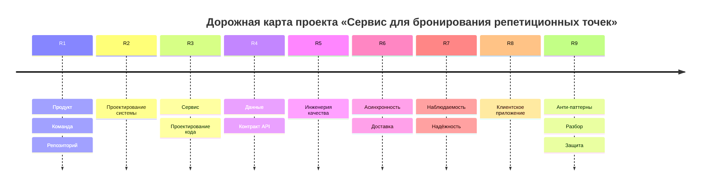

# Дорожная карта

## Вехи

| Веха | Название | Модули |
| --- | --- | --- |
| R1 | **Продукт, команда, репозиторий** | М01–М02 |
| R2 | **Проектирование системы** | М03–М06 |
| R3 | **Сервис и проектирование кода** | М07–М08 |
| R4 | **Данные и контракт API** | М09–М10 |
| R5 | **Инженерия качества** | М11 |
| R6 | **Асинхронность и доставка** | М12–М13 |
| R7 | **Наблюдаемость и надёжность** | М14 |
| R8 | **Клиентское приложение** | М15 |
| R9 | **Анти-паттерны, разбор, защита** | М16–М17 |
