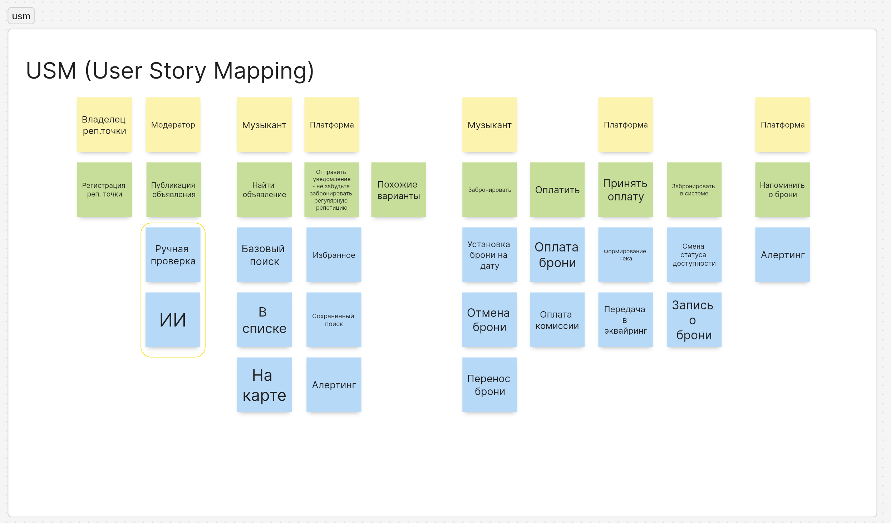

# Карта пользовательских историй

## Роли на карте

| Роль | Кто это |
| --- | --- |
| Владелец репетиционной точки | Персона № 1 из [requirements.md](requirements.md) |
| Музыкант | Персона № 2 из [requirements.md](requirements.md) |
| Модератор | Проверяет объявления перед публикацией; техническая роль |
| Платформа | Автоматические действия системы: уведомления, приём оплаты, учёт броней |

## Активности (позвоночник пути)

| Разместить точку | Найти зал | Забронировать | Оплатить | Получить напоминание |
| --- | --- | --- | --- | --- |

## Полная карта

Метка в начале строки показывает слой выпуска: MVP, v1.1 или v1.2.

### Активность: Разместить точку

Роли: Владелец репетиционной точки, Модератор.

- Задача: зарегистрировать репетиционную точку.
  - MVP · Как владелец, я хочу зарегистрировать точку с залами, оборудованием и ценами, чтобы клиенты увидели, что я предлагаю.
- Задача: опубликовать объявление.
  - MVP · Как модератор, я хочу вручную проверить объявление перед публикацией, чтобы в каталоге не было недостоверных точек.
  - v1.2 · Как модератор, я хочу, чтобы ИИ предварительно проверял объявления, чтобы разгрузить ручную проверку.

### Активность: Найти зал

Роли: Музыкант, Платформа.

- Задача: найти объявление.
  - MVP · Как музыкант, я хочу базовый поиск объявлений, чтобы быстро найти подходящую точку.
  - MVP · Как музыкант, я хочу видеть результаты списком, чтобы сравнить точки по цене и оборудованию.
  - v1.1 · Как музыкант, я хочу видеть точки на карте, чтобы выбрать ближайшую
- Задача: подобрать похожие варианты.
  - v1.1 · Как музыкант, я хочу видеть похожие варианты, если нужный зал занят, чтобы не начинать поиск заново.
- Задача: получить уведомление «не забудьте забронировать регулярную репетицию».
  - v1.2 · Как музыкант, я хочу добавлять точки в избранное, чтобы возвращаться к ним.
  - v1.2 · Как музыкант, я хочу сохранять поиск, чтобы не вводить условия каждый раз.
  - v1.2 · Как музыкант, я хочу получать оповещения о подходящих объявлениях, чтобы не пропустить свободный зал.

### Активность: Забронировать

Роли: Музыкант, Платформа.

- Задача: забронировать.
  - MVP · Как музыкант, я хочу забронировать свободный слот на дату, чтобы быть уверенным, что зал за мной.
  - MVP · Как музыкант, я хочу отменить свою бронь, чтобы слот освободился.
  - v1.1 · Как музыкант, я хочу перенести бронь на другое время, чтобы не отменять и не бронировать заново.
- Задача: забронировать в системе.
  - MVP · Как платформа, я хочу менять статус доступности слота после брони, чтобы двойная бронь была невозможна.
  - MVP · Как платформа, я хочу вести запись о брони, чтобы владелец и музыкант видели одно и то же.
  - MVP · Как владелец, я хочу видеть брони по залам, чтобы знать загрузку и не вести таблицу.

### Активность: Оплатить

Роли: Музыкант, Платформа.

- Задача: оплатить
  - MVP · Как музыкант, я хочу оплатить бронь онлайн, чтобы подтвердить её без переводов вручную.
  - v1.1 · Как владелец, я хочу оплачивать комиссию платформы, чтобы пользоваться сервисом.
- Задача: принять оплату.
  - MVP · Как платформа, я хочу передавать платёж в эквайринг, чтобы деньги проходили через шлюз.
  - v1.1 · Как музыкант, я хочу получить чек об оплате, чтобы иметь подтверждение платежа.

### Активность: Получить напоминание

Роль: Платформа.

- Задача: напомнить о брони.
  - v1.1 · Как музыкант, я хочу получать напоминание о брони, чтобы не забыть про репетицию.

## Позвоночник MVP

Владелец регистрирует точку и публикует объявление → модератор проверяет его → музыкант находит зал в списке → бронирует слот на дату → оплачивает → платформа принимает оплату и закрепляет слот → владелец видит бронь → музыкант может отменить бронь.

Это минимальный сквозной путь: убрав любой шаг, получим неработающий сценарий. Без регистрации и проверки нечего искать; без поиска и брони нечего оплачивать; без смены статуса слота возможны двойные брони.

## Слои релизов

| Релиз | Что добавляется |
| --- | --- |
| **MVP** | Регистрация точки, ручная проверка объявления, базовый поиск и список, бронь на дату, отмена, оплата через шлюз (тестовый режим), смена статуса слота и запись о брони, просмотр броней владельцем |
| **v1.1** | Карта, похожие варианты, перенос брони, чек, оплата комиссии, напоминание о брони |
| **v1.2** | Избранное, сохранённый поиск, оповещения о подходящих объявлениях, ИИ-проверка объявлений |
